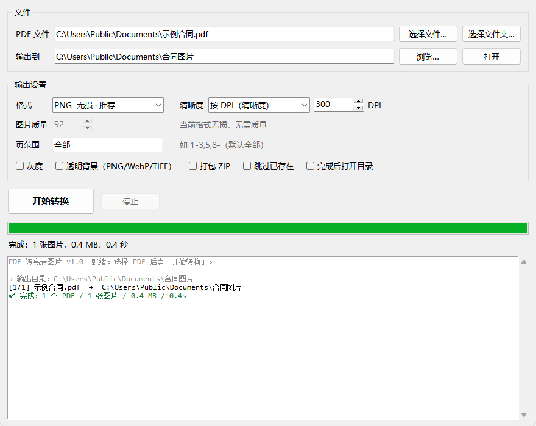
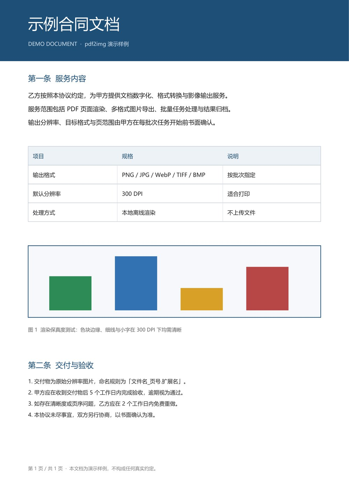

# PDF → 高清图片（pdf2img）

把 PDF 的每一页渲染成高清图片，输出 **PNG / JPG / WebP / TIFF / BMP**，可指定清晰度、页范围、批量目录。

渲染引擎用 **PyMuPDF（MuPDF）**，不需要安装 poppler / Ghostscript / ImageMagick，`pip install` 两个包就能跑。



---

## 特点

| 能力 | 说明 |
| --- | --- |
| 高清输出 | 默认 **300 DPI**，可指定任意 DPI，或按「长边像素 / 宽度像素 / 缩放倍数」输出 |
| 多种格式 | PNG、JPG、WebP、TIFF、BMP，质量与压缩参数可调 |
| 页范围 | `1-3,5,8-` 这类写法，只转需要的页 |
| 批量 | 单个文件、多个文件、整个文件夹（可递归）一次转完 |
| 透明背景 | PNG / WebP / TIFF 可保留透明通道；其它格式按底色合成 |
| 灰度 / 单色 | 扫描件转灰度或 1 位单色，体积可降一个数量级 |
| 扫描件原图提取 | `--extract-original` 直接从 PDF 里抽出内嵌原图，**无损、秒出** |
| 真实 DPI 元数据 | 输出图片带物理分辨率，排版、打印时尺寸正确 |
| 并行加速 | `-j N` 多进程渲染，长文档明显更快（受限环境自动降级为单进程） |
| 双入口 | 图形界面（双击即用）+ 命令行（可脚本化、可出 JSON 报告） |

---

## 安装

需要 Python 3.9+：

```bash
pip install -r requirements.txt
# 或者： pip install pymupdf pillow
```

---

## 用法一：图形界面

双击 **`启动界面.bat`**（或 `python pdf2img_gui.py`）：

1. 「选择文件…」挑 PDF（可多选），或「选择文件夹…」批量；
2. 选格式、清晰度（默认 300 DPI）、页范围；
3. 点「开始转换」，进度条与日志实时显示，完成后自动打开输出目录。

---

## 用法二：命令行

```bash
# 最常用：整份 PDF 转 PNG，300 DPI
python pdf2img.py 文件.pdf

# 转 JPG，450 DPI，质量 95
python pdf2img.py 文件.pdf -o out -f jpg --dpi 450 -q 95

# 只转第 1-3 页和第 8 页
python pdf2img.py 文件.pdf -o out -p 1-3,8

# 按长边 4000 像素输出（适合统一尺寸）
python pdf2img.py 扫件.pdf -f png --long-side 4000

# 整个文件夹批量转 JPG，4 进程并行，递归子目录
python pdf2img.py 合同目录 -o out -f jpg -j 4 --recursive

# 扫描件：直接抽内嵌原图，无损且极快
python pdf2img.py 扫描件.pdf -f png --extract-original
```

### 主要参数

| 参数 | 说明 | 默认 |
| --- | --- | --- |
| `-o, --out` | 输出目录 | `pdf2img_out` |
| `-f, --format` | `png` / `jpg` / `webp` / `tif` / `bmp` | `png` |
| `--dpi` | 渲染 DPI | `300` |
| `--width` / `--height` | 按像素宽 / 高输出（等比） | — |
| `--long-side` | 按长边像素输出 | — |
| `--scale` | 按倍数缩放（`2` = 144 DPI） | — |
| `-p, --pages` | 页范围，如 `1-3,5,8-`；`-2` 表示前 2 页 | 全部 |
| `-q, --quality` | JPG / WebP 质量 1–100 | `92` |
| `--jpg-subsampling` | `0`=4:4:4 最清晰，`2`=4:2:0 体积最小 | `0` |
| `--png-compress` | PNG 压缩级别 0–9 | `3` |
| `--gray` / `--mono` | 灰度 / 1 位单色 | 关 |
| `--transparent` | 保留透明背景（PNG/WebP/TIFF） | 关 |
| `--bg` | 不透明格式的底色 | `#FFFFFF` |
| `--no-annotations` | 不渲染批注与表单 | 关（即渲染） |
| `--password` | 加密 PDF 的打开密码 | — |
| `--name` | 文件名模板，字段：`stem/page/pageno/index/total/dpi` | `{stem}_p{page}` |
| `--skip-existing` | 跳过已存在图片 | 覆盖 |
| `-j, --jobs` | 并行进程数，`0` = 自动 | `1` |
| `--zip` | 额外打包 zip | 关 |
| `--flat` | 批量时全部输出到同一目录 | 每个 PDF 建子目录 |
| `--extract-original` | 扫描件优先抽取内嵌原图（无损） | 关 |
| `--json` | 输出执行报告 JSON | — |
| `--info` | 只查看 PDF 信息（页数、尺寸） | — |
| `--selftest` | 就地自检：生成测试 PDF，跑一遍全部格式 | — |
| `--dry-run` | 只显示计划，不写文件 | — |

### 输出规则

- 文件名默认 `原文件名_p001.png`（页号自动补零，变长文档也整齐）；
- 单个 PDF → 直接放在输出目录；
- 多个 PDF / 文件夹 → 每个 PDF 一个子目录，避免重名；
- `--name "{stem}-{page}"` 可自定义命名。

### 实测参考

同一台机器（Win11 / i7）上的单页转换耗时与体积：

| 页面类型 | 输出分辨率 | PNG | JPG | WebP | TIFF |
| --- | --- | --- | --- | --- | --- |
| A4 文字文档（300 DPI） | 2480 × 3509 | 0.42 MB / 0.7 s | 0.47 MB / 1.0 s | 0.20 MB / 0.9 s | 0.29 MB / 0.7 s |
| 大幅面图文页（14 × 20 英寸） | 4202 × 6091 | 9.0 MB / 1.8 s | 6.9 MB / 3.2 s | 4.6 MB / 3.4 s | 7.8 MB / 2.4 s |

几点说明：

- 纯文字页面大面积留白，PNG 反而压得比 JPG 更小；图片/扫描件页面则是 JPG、WebP 更省空间。
- JPG 默认 4:4:4 采样保清晰度，想更小用 `-q 85 --jpg-subsampling 2`。
- 单页耗时随 DPI 近似平方增长，300 → 600 DPI 约为 4 倍渲染量。

### 效果

上面示例文档转 300 DPI 后的 **100% 原始像素**局部，表格线、正文小字都锐利可读：


整页效果：



---

## 清晰度怎么选

| 场景 | 建议 |
| --- | --- |
| 屏幕阅读、预览 | 96–150 DPI |
| 手机/平板看、OCR 前处理 | 200–300 DPI |
| 打印、插入 Word/PPT | **300 DPI**（默认） |
| 印刷、放大细节、图纸 | 450–600 DPI |
| 统一封面尺寸 | `--long-side 3000` |

> 扫描件（整页本身就是一张位图）不需要更高 DPI 去「放大」，用 `--extract-original` 直接拿原始像素才是最高画质。

---

## 打包成独立 exe（免安装 Python）

### 便携单文件版（推荐：发给别人就这一个文件）

`portable\PDF转图片.exe`　约 44 MB，**没有任何配套文件**——放到任意目录、U 盘、桌面都能双击运行，不写注册表、不需要管理员权限、不用安装。

命令行版是 `portable\pdf2img-cli.exe`（约 41 MB），同样是单文件。

重新构建：

```powershell
powershell -ExecutionPolicy Bypass -File build_exe.ps1 -Mode onefile
```

### 目录版（可选，启动更快）

```powershell
powershell -ExecutionPolicy Bypass -File build_exe.ps1        # 默认 onedir
```

| 模式 | 产物 | 体积 | 启动 | 分发 |
| --- | --- | --- | --- | --- |
| **单文件** | `portable\PDF转图片.exe`<br>`portable\pdf2img-cli.exe` | 44 MB / 41 MB | 约 2–4 s（每次先解包） | 直接发 exe；微信/邮件拦截 exe 就发 `portable\PDF转图片-便携版.zip` |
| 目录版 | `dist\PDF转图片\PDF转图片.exe`<br>`dist\pdf2img-cli\pdf2img-cli.exe` | 91 MB / 84 MB | 约 0.3 s | **必须整个文件夹一起拷**，或发 `dist\PDF转图片-目录版.zip` |

说明：

- **目标电脑不需要安装 Python**，也不需要 VC++ 运行库；
- 把 PDF 文件**拖到 exe 上**，会自动开始转换，输出到该 PDF 同目录的 `pdf2img_out\`；
- 首次运行若出现 Windows SmartScreen 提示，点「更多信息 → 仍要运行」；
- 体积主要来自 MuPDF 渲染库（PyMuPDF），这是高保真渲染的代价；
- 单文件版每次启动都会解包到系统临时目录，所以比目录版慢 2–3 秒；若某台机器提示 `Could not create temporary directory`（临时目录被策略锁死），改用目录版即可。

---

## 兼容性（能在哪些 Windows 上跑）

| 系统 | 支持情况 |
| --- | --- |
| Windows 11 / 10（64 位，x64） | ✅ **支持并实测**（本机 Win11 22621；Win10 同架构） |
| Windows 11 ARM64 / Windows 10 ARM | ✅ 可运行（走系统自带的 x64 模拟） |
| Windows Server 2016+ | ✅ 应可用（同一套 API，未专门实测） |
| Windows 8.1 / 8 / 7 | ❌ 不支持：Python 3.13 与 MuPDF 已不再支持这些系统 |
| 32 位 Windows | ❌ 不支持：MuPDF 已不提供 32 位构建 |

打包是自包含的，**目标机不需要装 Python、不需要 VC++ 运行库**：`vcruntime140 / vcruntime140_1 / msvcp140 / ucrtbase` 连同 `python313.dll`、MuPDF、libjpeg、libtiff、zlib、libwebp、Tcl/Tk 全部在 `_internal\` 里。程序运行时不加载系统里安装的 Python，也不依赖 .NET。

已经验证过的场景：

- 清空 `PATH`、`PYTHONHOME`、`PYTHONPATH` 后运行 —— 正常，且运行时 **0 个模块来自本机 Python**；
- 放在**含空格和中文的目录**（`...\_portable 测试\工具 目录\`）—— 正常；
- 放在**只读目录**（仅读取+执行权限，等同 `C:\Program Files` 的普通用户视角）—— 正常；
- 中文文件名输入输出 —— 正常。

到一台新电脑上，用命令行版自证一下就最稳妥：

```bat
pdf2img-cli.exe --selftest
```

它会现场生成一个测试 PDF，把 PNG/JPG/WebP/TIFF/BMP 和中文路径都跑一遍，逐项打印「正常/失败」。

### 在纯净系统上验证（可选）

如果装了 **Windows 沙盒**（`启用或关闭 Windows 功能 → Windows 沙盒`），可以先在全新系统里试一次：

```xml
<!-- 存成 test.wsb，双击即可 -->
<Configuration>
  <MappedFolders>
    <MappedFolder>
      <HostFolder>C:\Tools\pdf2img\dist</HostFolder>
      <SandboxFolder>C:\app</SandboxFolder>
      <ReadOnly>true</ReadOnly>
    </MappedFolder>
  </MappedFolders>
  <LogonCommand>
    <Command>cmd /k C:\app\pdf2img-cli\pdf2img-cli.exe --selftest</Command>
  </LogonCommand>
</Configuration>
```

沙盒里没有任何 Python / VC++ 运行库，能跑通就说明换台机器也没问题。

---

## 常见问题

**双击 exe 弹「Failed to load Python DLL … _internal\python313.dll」？**
这是把**目录版**的 exe 从文件夹里单独拷出来了（或解压时只拿了 exe），它找不到同级的 `_internal` 目录。两个解法：整个文件夹一起拷；或者改用**单文件版** `portable\PDF转图片.exe`，它只有一个文件，不会出现这个问题。

**JPG 怎么比 PNG 还大？**
默认 `--jpg-subsampling 0`（4:4:4）优先保清晰度。想压体积用 `-q 85 --jpg-subsampling 2`。

**TIFF 打开有问题？**
部分 Windows 环境的 Pillow 自带 libtiff 有缺陷（读压缩 TIFF 会崩）。本工具的 TIFF 由内置编码器写出（deflate），已用 Windows GDI+ 独立验证可正常打开；若你的查看器仍异常，改用 PNG 即可。

**JPG 报「broken data stream when writing image file」？**
这是 Pillow 的 libjpeg 在受限账户/受限会话（没有可写的临时目录）里编码失败。程序会自动改用 MuPDF 自带的 JPEG 编码器继续输出，结果正常，只是日志里会提示一句。

**`-j` 提示「当前环境不允许创建子进程」？**
在受限沙箱里 Windows 多进程需要的命名管道被禁用，工具会自动改单进程，结果不变、只是慢一点。在普通终端里 `-j 4` 正常生效。

**超大页面报「超出安全上限」？**
单页像素超过 4 亿会拒绝渲染以免爆内存，降低 `--dpi` 或改用 `--long-side` 即可。

**PDF 有密码？**
`--password 密码`；界面里先解密再选文件，或用命令行。

**中文文件名乱码？**
工具全程使用 UTF-8 处理路径；批处理里若路径含中文，直接拖拽到 `拖拽转换.bat` 上最稳。

---

## 文件说明

```
pdf2img/
├── pdf2img.py          # 核心库 + 命令行（可被其它程序 import）
├── pdf2img_gui.py      # 图形界面
├── selftest.py         # 环境与功能自检：python selftest.py
├── exe_gui.py          # 打包入口（图形界面 exe）
├── exe_cli.py          # 打包入口（命令行 exe）
├── build_exe.ps1       # 一键打包 exe（-Mode onedir|onefile）
├── assets/             # 图标与 exe 版本信息
├── docs/               # 截图与预览图
├── 启动界面.bat         # 双击打开图形界面（需 Python）
├── 拖拽转换.bat         # 把 PDF 拖到它上面即可转 PNG 到 out\（需 Python）
└── requirements.txt
```

> 仓库里不含二进制产物；exe 请到 [Releases](../../releases) 下载，或按上面的方法自行打包。

作为库调用：

```python
from pdf2img import Options, convert_pdf

res = convert_pdf("input.pdf", Options(out_dir="out", fmt="jpg", dpi=300, pages="1-5"))
for img in res.images:
    print(img.page, img.path, img.width, img.height, img.dpi)
```

---

## 自检

```bash
python selftest.py
```

会现场生成一个测试 PDF，覆盖参数解析、五种格式、页范围/命名、尺寸模式、灰度/单色/透明、批量/ZIP、错误处理共 25 项检查。
